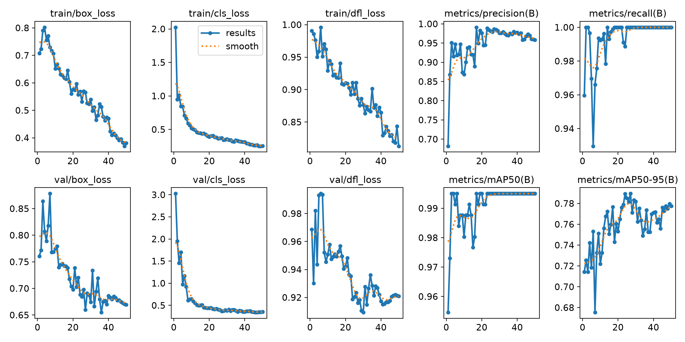
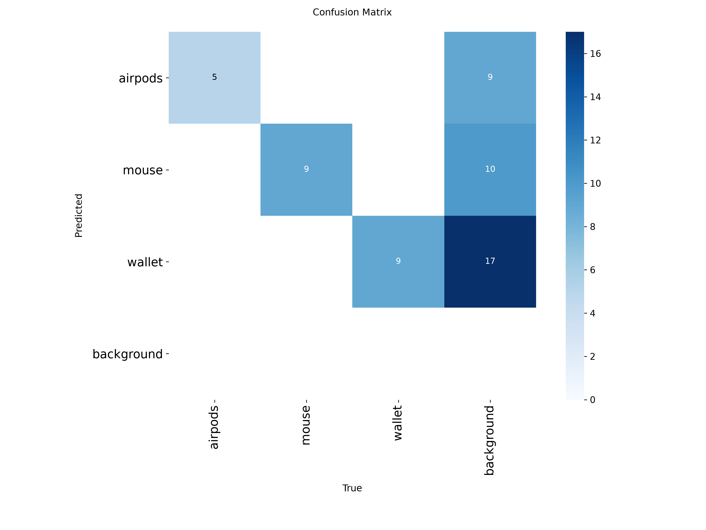

# YOLOv8 Custom Object Detection & Tracking

충북대학교 소프트웨어학부 머신러닝 과제용 커스텀 YOLOv8 객체 탐지 및 추적(Tracking) 프로젝트입니다.  
직접 촬영하여 수집한 3개 클래스(`airpods`, `mouse`, `wallet`) 100장의 이미지 데이터셋으로 YOLOv8 모델을 전이 학습하고, 새로운 5초 테스트 영상에서 객체 감지 및 이동 궤적(Trajectory)을 시각화했습니다.

---

## 1. 프로젝트 개요
- **탐지 대상 (3 Classes):**
  - `airpods`: 에어팟 케이스
  - `mouse`: 무선 마우스
  - `wallet`: 지갑
- **데이터셋 구축:** 직접 촬영한 영상에서 100장의 이미지를 추출한 뒤, [Roboflow](https://app.roboflow.com)를 이용해 바운딩 박스 라벨링 및 Train / Valid / Test 분할 진행 (YOLOv8 포맷 Export)
- **모델 및 추적:** Ultralytics `YOLOv8n` 전이 학습 + `ByteTrack` 기반 객체 추적 및 중심점 이동 궤적(Trajectory) 시각화

---

## 2. 저장소 구조
```text
├── weights/
│   └── best.pt                  # 학습 완료된 커스텀 YOLOv8 모델 가중치
├── demo/
│   └── tracked_result_10sec.mp4  # 5초 객체 감지 및 추적 결과 동영상
├── results/
│   ├── results.jpg              # Epoch별 Loss 및 성능 지표 학습 곡선
│   └── confusion_matrix.png     # 검증 데이터셋 혼동 행렬
├── data.yaml                    # 데이터셋 경로 및 3개 클래스 정의 파일
├── train.py                     # YOLOv8 커스텀 전이 학습 스크립트
├── track.py                     # 객체 탐지·추적 및 궤적 시각화 스크립트
└── README.md
```

---

## 3. 개발 환경 및 학습 설정
- **OS / Environment:** Windows, Python 3.11 (`venv` 가상환경)
- **Libraries:** Ultralytics YOLOv8, OpenCV (`opencv-python`)
- **Base Model:** `yolov8n.pt` (Pre-trained Weights)
- **Hyperparameters:**
  - `epochs`: 50
  - `imgsz`: 640
  - `batch`: 8
  - `tracker`: ByteTrack (`bytetrack.yaml`, `persist=True`, `conf=0.4`)

---

## 4. 학습 결과 및 성능 분석

### 4.1 주요 성능 지표 (50 Epoch 기준)
`results.jpg` 학습 곡선 기준 최종(및 최고) 검증 성능은 다음과 같습니다.

| Metric | Final (Epoch 50) | Best (Peak) | 비고 |
| :--- | :---: | :---: | :--- |
| **Precision (B)** | 약 0.96 | 약 0.99 | 20 epoch 이후 0.95 이상 안정 유지 |
| **Recall (B)** | **1.00** | **1.00** | 약 25 epoch 이후 모든 정답 객체 100% 탐지 |
| **mAP@0.5** | **0.995** | **0.995** | 약 25 epoch 이후 최고치 유지 |
| **mAP@0.5:0.95** | 약 0.78 | 약 0.79 | 후반부로 갈수록 박스 위치 정밀도 향상 |

### 4.2 학습 곡선 (`results.jpg`)


- **손실 함수 수렴 (Loss Convergence):**
  - `train/box_loss`는 약 0.71에서 0.38로, `train/cls_loss`는 약 2.0에서 0.25 수준으로, `train/dfl_loss`는 약 0.99에서 0.82로 50 epoch 동안 꾸준히 감소했습니다.
  - 검증 손실(`val/box_loss` 약 0.67, `val/cls_loss` 약 0.35, `val/dfl_loss` 약 0.92) 역시 초반 변동 이후 안정적으로 수렴하여 심각한 과적합 없이 학습이 완료되었습니다.
- **탐지 정확도 추이:**
  - `mAP@0.5`가 25 epoch 부근에서 0.995에 도달해 유지되었으며, IoU 임계값을 0.50부터 0.95까지 엄격하게 평가하는 `mAP@0.5:0.95`도 약 0.78~0.79 수준까지 상승했습니다.

### 4.3 혼동 행렬 분석 (`confusion_matrix.png`)


- **클래스 간 완벽한 구분 (Recall 100%):**
  - 검증 데이터셋에 포함된 3개 클래스의 실제 객체(`airpods` 5개, `mouse` 9개, `wallet` 9개 — 총 23개)를 단 하나의 누락(FN)이나 클래스 간 오분류 없이 모두 정확히 예측했습니다.
- **배경 오탐지(Background FP) 해석 및 추론 시 보완:**
  - 혼동 행렬의 `background` 열에서 `airpods`(9), `mouse`(10), `wallet`(17)의 오탐지(FP)가 관찰되었습니다. 이는 Ultralytics 혼동 행렬 생성 시 기본 신뢰도 임계값(`conf=0.25`)이 낮게 설정되어 있어, 배경 영역의 낮은 확신도 후보 상자들이 포함되었기 때문입니다.
  - 반면 최적 임계값 기준의 `metrics/precision(B)`은 0.96~0.99로 매우 높게 나타났으며, 실제 동영상 추론 스크립트(`track.py`)에서도 `conf=0.4` 이상으로 임계값을 상향 적용하여 배경 오탐지를 효과적으로 억제했습니다.

---

## 5. 객체 감지 및 추적 결과 (10초 데모)
학습에 사용하지 않은 새로운 10초 테스트 영상(`.mov`)을 입력으로 넣어 3개 클래스의 실시간 객체 탐지 및 추적을 수행했습니다.
- **적용 기능:**
  - `model.track(..., persist=True, tracker="bytetrack.yaml")`를 통한 프레임 간 객체 고유 ID 유지
  - 각 객체의 중심 좌표(`xywh`)를 누적하여 최근 30프레임의 이동 궤적(Trajectory)을 초록색 선으로 시각화

> 결과 동영상은 저장소 내 [`demo/tracked_result_10sec.mp4`](demo/tracked_result_10sec.mp4) 파일에서 확인할 수 있습니다.

---

## 6. 실행 방법

### 1) 가상환경 생성 및 활성화 (Windows PowerShell)
```powershell
python -m venv venv
Set-ExecutionPolicy -ExecutionPolicy RemoteSigned -Scope Process
.\venv\Scripts\Activate.ps1
pip install ultralytics opencv-python
```

### 2) 커스텀 모델 학습
```powershell
python train.py
```

### 3) 5초 동영상 객체 감지 및 추적
```powershell
python track.py
```

---

## 7. 트러블슈팅 및 경험 정리
- **데이터셋 구축:** Roboflow에서 연속 프레임 라벨링 도구와 클래스 정리를 활용해 3개 클래스 100장의 학습 데이터를 효율적으로 구축했습니다.
- **Windows 개발 환경 세팅:** Windows 기본 앱 실행 별칭(`python.exe`) 충돌 문제를 해결하고, `venv` 가상환경을 분리해 의존성 충돌 없이 PyTorch 및 Ultralytics 환경을 구성했습니다.
- **경로 및 포맷 대응:** Ultralytics 학습 결과의 중첩 저장 경로(`runs/detect/...`)와 iOS 촬영 영상(`.mov`) 입력 처리를 코드에 반영하여 안정적으로 결과 영상(`.mp4`)을 생성했습니다.
